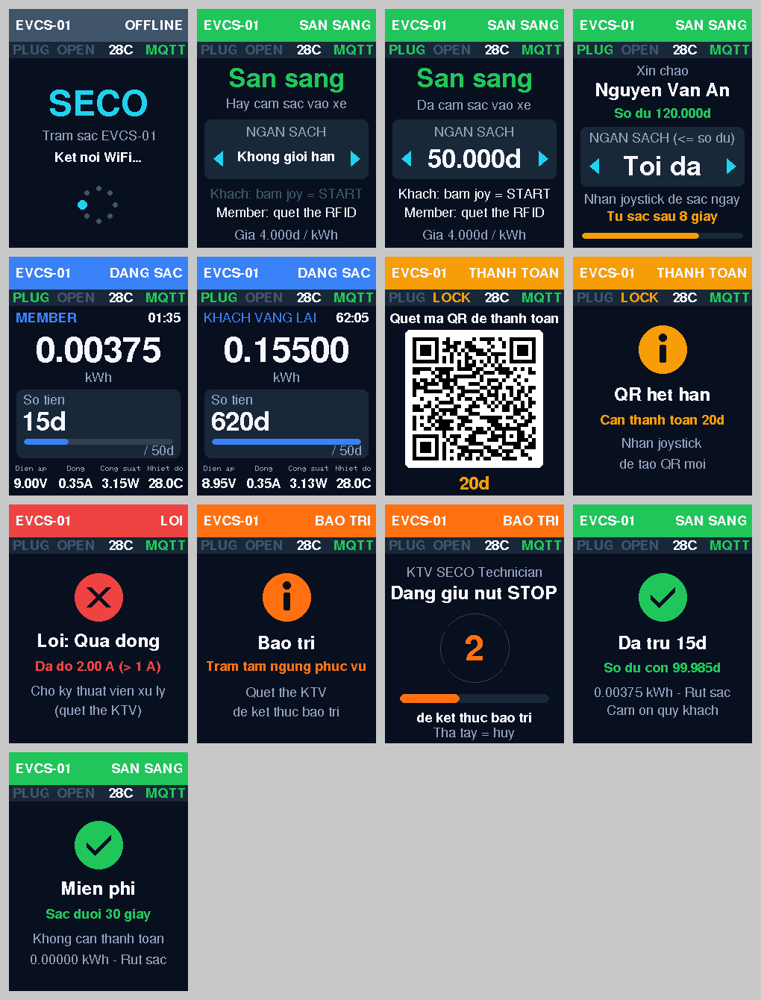

# Trụ sạc EVCS-01 (Wokwi)

Mô phỏng một trụ sạc SECO hoàn chỉnh theo DD v1.2 và Proposal, gồm các luồng:

- **Member:** quẹt thẻ RFID để sạc, tiền trừ vào ví.
- **Guest (khách vãng lai):** chọn ngân sách, nhấn START (nhấn joystick) để sạc, rút sạc, quét QR thanh toán.
- **An toàn:** quá nhiệt hoặc quá dòng thì tự ngắt điện và kết thúc phiên (khách thanh toán QR ngay, member bị trừ ví).
- **Kỹ thuật viên:** bảo trì bằng thẻ KTV và nút STOP giữ 3 giây.
- **Admin:** điều khiển trụ từ xa qua web.

Trụ giao tiếp với API qua MQTT `evcs/EVCS-01/*`.

## Chạy

Mọi lệnh chạy sau `conda activate iad`.

Trụ dùng API đã deploy trên Render (`https://seco-backend-api.onrender.com`) và web trên Vercel (`https://iad-seco.vercel.app`). **Không cần chạy gì trên máy**: không Docker, không API, database hay broker local.

Trụ và API dùng chung broker `broker.hivemq.com`. Trong Wokwi trụ nối cổng 1883 (không TLS, `MQTT_TLS 0`) vì gateway của Wokwi không mở được TLS tới cổng 8883 (`MQTT connect failed, rc=-2`); đây là một broker cho cả hai cổng nên API (8883) vẫn nhận đủ.

1. `cd simulator/station && ./build.sh` để build firmware.
2. Trong VS Code, mở `simulator/station/diagram.json` rồi chạy **Wokwi: Start Simulator**.
3. Mở web admin. Trạm `EVCS-01` (đã có trong seed) chuyển sang online và cập nhật realtime.

`broker.hivemq.com` là broker công khai: ai cũng đọc và gửi được vào topic `evcs/...`. Chỉ nên dùng để demo. Với broker riêng (HiveMQ Cloud), điền `MQTT_HOST`, `MQTT_USERNAME`, `MQTT_PASSWORD` trong sketch, và đặt các giá trị tương ứng trên Render.

Hai linh kiện tự làm, INA219 và pin 9V, đã được biên dịch sẵn thành `chips/*.chip.wasm`. Chỉ cần chạy `chips/build.sh` khi sửa file `.chip.c`; script tự tải wasi-sdk.

## Sơ đồ khối

```
                  SPI (SCK 12, MOSI 11, MISO 13)            I2C (SDA 8, SCL 9)
   TFT ILI9341 (CS 15, DC 6, RST 21) ◄─┬─► MFRC522 (SS 10)      INA219 0x40
                                       │                           ▲
                          ┌────────────┴────────────┐              │
     PLUG 5, STOP 7 ─────►│        ESP32-S3         │◄─────────────┘
     joystick 1 / 2 ─────►│                         ├── GPIO 4 ──► DS18B20 (nhiệt độ)
                          └──┬──────┬──────┬────────┘
             5 đèn trạng thái │   relay 16  servo 17 ──► khóa đầu sạc   còi 18
                 (38 - 42)    │
   Mạch công suất (sạc):
   Pin 9V (+) ──► relay COM ─[NO]─► INA219 VIN+ ─[shunt 0.1Ω]─ VIN- ──► EV (LED trắng) ──► GND ◄── Pin 9V (−)
```

Relay đóng thì pin 9V cấp điện cho "xe" (LED **EV** sáng), và INA219 đo được điện áp, dòng, công suất thật. Relay mở thì cả ba về 0.

## Chức năng từng linh kiện

### Bộ điều khiển và nguồn

| Linh kiện | ID | Chân | Chức năng |
|---|---|---|---|
| ESP32-S3 DevKitC-1 | `esp` | – | Bộ điều khiển trung tâm. Chạy firmware `sketch.ino`, kết nối WiFi `Wokwi-GUEST`, nói chuyện với API qua MQTT, đọc cảm biến, điều khiển relay, servo, đèn và màn hình. |
| Breadboard half | `bb1` | – | Chia nguồn và nối bus. Rail **trên**: 3.3V (`tp`) và GND (`tn`) cho cảm biến, nút, màn TFT, INA219. Rail **dưới**: 5V (`bp`) và GND (`bn`) cho relay, servo, đèn RGB. Cột 1 và 2 là bus I2C (SDA, SCL) dùng chung cho ESP và INA219; cột 6, 7, 8 là bus SPI (MOSI, SCK, MISO) dùng chung cho ESP, MFRC522 và màn TFT. Mỗi chân ESP chỉ có **một** dây. |
| Pin 9V | `battery` | BAT+ → relay COM, BAT− → GND | **Nguồn sạc**, tức nguồn năng lượng đổ vào xe. Đây là custom chip vì Wokwi không có pin. |

### Giao tiếp người dùng

| Linh kiện | ID | Chân ESP | Chức năng |
|---|---|---|---|
| Màn TFT 2.8" ILI9341 (240x320, màu) | `tft` | CS 15, D/C 6, RST 21, MOSI 11, SCK 12, MISO 13 (SPI dùng chung với RFID qua breadboard cột 6–8), VCC/LED 3.3V | Màn hình của trụ, lớn nhất trong Wokwi. **Thanh tiêu đề đổi màu theo trạng thái**: xanh lá READY, màu chủ đạo của web (#437066) CHARGING, vàng chờ thanh toán, đỏ ERROR, cam bảo trì, xám offline. Bên dưới là dải trạng thái `PLUG · LOCK · nhiệt độ · MQTT`, rồi đến nội dung từng màn (xem mục *Màn hình*). Khi khách cần trả tiền, màn hiện **mã QR cỡ lớn**. Mỗi ô chữ có vị trí cố định và chỉ được vẽ lại khi nội dung đổi, nên không nháy và không đè chữ. |
| Đầu đọc RFID MFRC522 | `rfid` | SDA 10, MOSI 11, SCK 12, MISO 13, RST 14 | Đọc thẻ của **member** để bắt đầu sạc, hoặc thẻ của **kỹ thuật viên** để bảo trì. Bấm vào đầu đọc trong Wokwi để chọn thẻ rồi bấm *Tap*. |
| Joystick | `joystick` | HORZ 1 (ADC), SEL 2 | Điều khiển duy nhất của khách hàng, đóng vai trò **nút START**. **Gạt trái / phải**: chọn ngân sách (ô **NGAN SACH** trên màn hình). Ở màn hình chào, các mức cho khách là Khong GH, 10.000, 20.000, 50.000, 100.000, 200.000, 500.000đ. Sau khi member quẹt thẻ, chỉ còn các mức **≤ số dư**: `Toi da` (sạc đến khi hết số dư), rồi các mức cố định. **Nhấn**: = **START** của khách; = **OK** của member (bắt đầu sạc; trụ không tự sạc); khi QR hết hạn thì tạo QR mới. |
| Nút STOP (đỏ) | `btnStop` | GPIO 7 | Dành cho **kỹ thuật viên**. Sau khi quẹt thẻ KTV, **giữ 3 giây** để vào hoặc ra bảo trì. Nhấn STOP mà không có thẻ KTV thì không có tác dụng (DD 3.3). |
| Còi | `buzzer` | GPIO 18 | Phản hồi âm thanh: bíp ngắn khi quẹt thẻ hoặc nhấn nút, bíp cao khi thành công, bíp trầm và dài khi lỗi, quá nhiệt hoặc quá dòng. |

### Cảm biến và công tắc an toàn

| Linh kiện | ID | Chân ESP | Chức năng |
|---|---|---|---|
| Nút PLUG | `plug` | GPIO 5 | Mô phỏng **micro-switch ở đầu sạc**: nút nhấn, **mỗi lần nhấn = cắm sạc / rút sạc**. Rút sạc khi đang sạc sẽ gửi event `UNPLUGGED`, API kết thúc phiên. |
| Cảm biến nhiệt DS18B20 | `temp` | GPIO 4 (1-Wire) | Đo nhiệt độ trụ mỗi giây. Kéo thanh nhiệt độ lên **≥ 35°C** thì relay ngắt, trụ gửi `OVER_TEMPERATURE` và chuyển sang ERROR. Nếu mất cảm biến thì gửi `SENSOR_FAULT`. Nhiệt độ cũng được gửi lên server trong telemetry. |
| INA219 | `ina219` | SDA 8, SCL 9 (I2C 0x40), VIN+ / VIN− trên đường điện sạc | **Đo điện áp, dòng và công suất thật** trên đường pin → xe, gửi lên server mỗi 3 giây khi đang sạc. Đây là custom chip giả lập con INA219 thật: đủ các thanh ghi, shunt 0.1Ω, và firmware đọc bằng thư viện **Adafruit_INA219** như trên phần cứng. Hai thanh trượt: **điện áp pin** (mặc định 9V) và **dòng sạc** (mặc định 350 mA). **Bảo vệ quá dòng:** dòng > 1 A trong 0,5 giây thì relay ngắt và trụ báo sự cố. Chi phí vẫn tính theo thời gian theo DD (0,00125 kWh mỗi 30 giây). |

### Chấp hành

| Linh kiện | ID | Chân ESP | Chức năng |
|---|---|---|---|
| Relay | `relay` | IN 16 (VCC 5V) | **Relay fail-safe**, mặc định **TẮT** khi khởi động. Đóng thì nối pin 9V vào xe. Firmware chỉ cho đóng khi đã cắm sạc, nhiệt độ dưới 35°C **và** server đã mở phiên sạc. Relay tự ngắt khi mất kết nối MQTT. |
| Servo | `lock` | PWM 17 (V+ 5V) | **Khóa đầu sạc**: 0° = mở, 90° = khóa. Trong luồng khách, sau khi rút sạc, server gửi `LOCK` để giữ đầu sạc cho đến khi thanh toán xong (`UNLOCK`). Mỗi lần khóa hoặc mở, trụ trả `cmd_ack` để web biết trạng thái khóa. |
| LED EV (trắng) | `ev` | Cấp từ INA219 VIN− | Mô phỏng **chiếc xe đang được sạc**. LED sáng khi có điện từ pin chạy qua relay và INA219. |

### Đèn trạng thái

Một **LED RGB** (common cathode): R → GPIO 41, G → GPIO 38, B → GPIO 39, chân chung → GND (trên mạch thật mỗi chân màu qua điện trở 220Ω). Màu của đèn là trạng thái của trạm:

| Màu | Sáng liên tục | Nhấp nháy |
|---|---|---|
| 🟢 Xanh lá | Station `READY` | Đang chờ `STATION_SYNC` sau khi kết nối |
| 🔵 Xanh dương | Station `CHARGING` | Đang gửi `SESSION_START` / `GUEST_START`, hoặc đang chờ server dừng phiên |
| 🟡 Vàng | Session `WAITING_PAYMENT`, Payment `PENDING` | Payment `EXPIRED` hoặc `CANCELLED`, nhấn joystick để tạo QR mới |
| 🔴 Đỏ | Station `ERROR` | **Mất kết nối** WiFi hoặc MQTT (trạm offline) |
| 🟠 Cam | Station `MAINTENANCE` | – |

Khách đang sạc mà gặp sự cố (quá nhiệt / quá dòng): trạm `ERROR` nhưng khách vẫn phải trả tiền, nên đèn đổi luân phiên **đỏ / vàng** và màn hình vẫn hiện mã QR.

## Trạng thái (theo bảng của DD)

Firmware giữ đúng các giá trị như API. Khi kết nối lại, trụ gửi `STATION_SYNC` để lấy lại toàn bộ trạng thái từ server. Heartbeat (`hb`) gửi lại các trạng thái này để dễ debug.

| Đối tượng | Giá trị | Trụ dùng để |
|---|---|---|
| Station | `READY` \| `CHARGING` \| `ERROR` \| `MAINTENANCE` | Đèn trạng thái. Chỉ nhận thẻ member hoặc START (nhấn joystick) khi `READY` và không có phiên mở. Thẻ KTV dùng được khi `ERROR` / `MAINTENANCE` (hoặc `READY` để bảo trì chủ động). Sau khi thanh toán xong, trạm vẫn giữ `ERROR` / `MAINTENANCE` nếu đang ở trạng thái đó. |
| Session | `ACTIVE` \| `WAITING_PAYMENT` \| `COMPLETED` \| `ERROR` | `ACTIVE`: relay đóng, màn hình đang sạc. `WAITING_PAYMENT`: hiện QR, đèn 🟡. `COMPLETED` / `ERROR`: không còn phiên mở trên trụ. |
| Payment | `PENDING` \| `PAID` \| `EXPIRED` \| `CANCELLED` | `PENDING`: hiện QR. `EXPIRED` / `CANCELLED`: "QR het han / da huy", nhấn joystick để tạo mới. `PAID`: server gửi `UNLOCK`, phiên kết thúc. |
| Connector lock | `UNLOCKED` \| `LOCKED` \| `UNKNOWN` | Vị trí servo. Là `UNKNOWN` từ lúc khởi động đến khi đồng bộ, sau đó theo lệnh `LOCK` / `UNLOCK`. Mỗi lần đổi, trụ trả `cmd_ack` kèm `connector_lock`. |
| Stop reason | `UNPLUG` \| `MAX_BUDGET` \| `INSUFFICIENT_BALANCE` \| `TECHNICIAN` \| `OVER_TEMPERATURE` \| `E_STOP` \| `SYSTEM_ERROR` | Do server quyết định và gửi kèm lệnh `STOP`; trụ hiện lý do trên màn hình. Trụ gây ra lý do bằng các event: `UNPLUGGED` → `UNPLUG`, `OVER_TEMPERATURE` → `OVER_TEMPERATURE`, `FAULT` (quá dòng) và `SENSOR_FAULT` → `SYSTEM_ERROR`. Trạm không có nút E-Stop, nên `E_STOP` chỉ còn trong dữ liệu cũ. |

## Màn hình



Hàng 1: khởi động, READY chưa cắm sạc, READY đã chọn ngân sách, member vừa quẹt thẻ.
Hàng 2: đang sạc (member / khách), mã QR thanh toán, QR hết hạn.
Hàng 3: lỗi quá dòng, bảo trì, KTV đang giữ STOP (đếm ngược 3 giây), member xong phiên (số tiền đã trừ).
Hàng 4: khách sạc dưới 30 giây (miễn phí).

| Trạng thái | Nội dung |
|---|---|
| Khởi động / offline | **SECO**, mã trụ, "Ket noi WiFi... / may chu... / Dong bo trang thai...", vòng xoay |
| Sẵn sàng | **San sang**, đã cắm sạc hay chưa, ô **NGAN SACH** `◀ 50.000d ▶` (gạt joystick để đổi), hướng dẫn cho khách và member, giá 4.000đ/kWh |
| Member vừa quẹt thẻ | "Xin chao", **tên**, số dư, ô **NGAN SACH (<= so du)**, "Tu sac sau 8 giay" kèm thanh đếm ngược |
| Đang sạc | MEMBER / KHÁCH và thời gian, **số kWh** cỡ lớn, ô **số tiền** kèm thanh tiến độ so với ngân sách, điện áp / dòng / công suất (INA219) và nhiệt độ |
| Chờ thanh toán | **Mã QR** chiếm gần hết màn (khoảng 165 px), số tiền ở dưới. Link trong QR cũng được in ra Serial Monitor. |
| Kết thúc phiên member | ✓ **Da tru 15d**, "So du con 99.985d", số kWh và lý do dừng (lấy từ hóa đơn thật trong lệnh `STOP`) |
| Khách sạc dưới 30 giây | ✓ **Mien phi**: phiên 0đ kết thúc luôn, không có QR (mỗi 30 giây mới tính 5đ, theo DD) |
| QR hết hạn / bị hủy | ⓘ **QR het han**, số tiền cần trả, "Nhan joystick de tao QR moi" |
| Lỗi | ✗ **Loi: Qua nhiet / Qua dong**, giá trị đo được, "Cho ky thuat vien xu ly" hoặc "KTV: giu STOP 3 giay" |
| Bảo trì | ⓘ **Bao tri**, "Quet the KTV" hoặc "Giu STOP 3 giay de ket thuc bao tri" |
| KTV đang giữ STOP | Chỉ một màn đếm ngược **3 → 2 → 1** cỡ lớn kèm thanh tiến độ và tên KTV. Thả tay trước 3 giây thì về lại màn bảo trì / lỗi; đủ 3 giây thì trụ gửi `TECHNICIAN_ACTION`. |

## Thanh toán QR cho khách (trang Sandbox)

QR mở trang **`https://iad-seco.vercel.app/pay/<payment_id>`** trên web. Trang này không cần đăng nhập và hiện số tiền, trạm, số kWh, thời gian và lý do dừng.
- Bấm **Thanh toán** thì payment chuyển `PAID`, server gửi `UNLOCK`: servo mở khóa, trụ về READY.
- Bấm **Hủy** thì payment chuyển `CANCELLED`, nhấn joystick trên trụ để tạo QR mới.

Đầu sạc **chỉ mở khóa khi đã thanh toán** (DD 3.2). Admin vẫn có lệnh `UNLOCK` trên web cho trường hợp khẩn cấp.

Link trỏ tới web trên Vercel (`GUEST_PAYMENT_URL_BASE` đặt trên Render), nên **quét bằng điện thoại thật** được ngay.

## Các luồng (thao tác trong Wokwi)

**Chọn thẻ:** bấm vào đầu đọc MFRC522 trong Wokwi, chọn thẻ rồi bấm **Tap**.

| Thẻ Wokwi | UID | Chủ thẻ (seed) | Dùng cho |
|---|---|---|---|
| **Blue Card** | `A1B2C3D4` | `user@seco.com` (MEMBER) | Luồng member |
| **Key Fob** | `C0FFEE99` | `tech@seco.com` (TECHNICIAN) | Luồng kỹ thuật viên |
| Green / Yellow / Red / NFC Tag | `11223344`, `55667788`, `AABBCCDD`, `04112233445566` | chưa gán | Thử thẻ không hợp lệ (`The khong hop le`) |

Có thể gõ UID vào Serial Monitor rồi Enter thay cho việc chạm thẻ, ví dụ `7E1C2A9F` là thẻ KTV thật của seed. Thẻ Key Fob cần chạy lại seed một lần sau khi pull: `cd apps/api && python -m app.db.seed`. Seed chỉ thêm thẻ, không đổi mật khẩu hay số dư.

**Màn hình chào**: trạm READY hiện "Xin chao!". Quẹt thẻ thành viên thì trạm nhận diện **THÀNH VIÊN** (tên + số dư); không quẹt thẻ thì khách sạc với tư cách **KHÁCH**.

**Member (DD 3.1: READY → quét RFID → tên + số dư → max budget (tùy chọn) → CHARGING)**
1. Nhấn nút **PLUG** (cắm sạc vào xe).
2. Quẹt thẻ: trụ gửi `RFID_VERIFY`, màn hình hiện **THÀNH VIÊN**, **tên** và **số dư**.
3. (Tùy chọn) Gạt joystick chọn ngân sách. Chỉ có các mức **≤ số dư**. `Toi da` nghĩa là không đặt ngân sách: sạc đến khi hết số dư hoặc rút sạc.
4. **Nhấn joystick để bắt đầu sạc** (trụ không tự sạc). Trụ gửi `SESSION_START`, relay đóng, LED EV sáng, đèn RGB xanh dương. Nếu chưa cắm sạc, trụ chờ tối đa 30 giây và sạc ngay khi nhấn PLUG. Để yên **60 giây** không thao tác thì trụ huỷ và quay về màn hình chào.
5. Phiên dừng khi đạt ngân sách, không đủ số dư (server gửi `STOP`), rút sạc (nhấn PLUG lần nữa), hoặc có sự cố an toàn. Server tính tiền thực tế và trừ ví; màn hình hiện **số tiền đã trừ** và **số dư còn lại**.

**Khách (sạc trước, trả QR sau)**
1. (Tùy chọn) Ở màn hình chào, gạt joystick chọn ngân sách. Không cần thẻ RFID.
2. Nhấn PLUG, **nhấn joystick (START)**: trụ gửi `GUEST_START`, bắt đầu sạc.
3. Nhấn PLUG lần nữa (rút sạc): trụ gửi `UNPLUGGED`. Server gửi `STOP`, rồi `LOCK` (servo xoay 90°, đèn vàng), rồi `PAYMENT_QR` (**QR cỡ lớn trên màn TFT**). Phiên phải dài **ít nhất 30 giây** mới có tiền và QR; ngắn hơn thì miễn phí.
4. Quét QR (hoặc bấm link trong Serial Monitor), trên trang Sandbox bấm **Thanh toán**. Server gửi `UNLOCK`: servo mở, trụ về READY.
5. Nếu QR hết hạn: đèn 🟡 nhấp nháy, nhấn joystick để lấy QR mới.

**An toàn**
Trạm không có nút E-Stop. Hai cảm biến tự phát hiện sự cố trong lúc sạc:
- **Quá nhiệt:** kéo thanh nhiệt độ DS18B20 lên **≥ 35°C**. Trụ gửi `OVER_TEMPERATURE`.
- **Quá dòng:** kéo thanh **Dong sac** của INA219 lên **> 1000 mA** trong lúc đang sạc. Mặc định là 350 mA. Thử xong nhớ kéo về 350, nếu không phiên sau sẽ bị ngắt ngay khi vừa bắt đầu. Sau 0,5 giây trụ gửi `FAULT`, server ghi lý do dừng là `SYSTEM_ERROR`.

Khi đó relay **tự ngắt ngay** (LED EV tắt), rồi server kết thúc phiên:
- **Khách:** khóa đầu sạc và hiện QR để **thanh toán ngay** số điện đã sạc.
- **Member:** **trừ ví** theo số điện thực tế, phiên kết thúc.

Trạm chuyển sang `ERROR` (đèn 🔴) đến khi kỹ thuật viên kiểm tra theo DD 3.3.

**Kỹ thuật viên**
1. Ở ERROR: quẹt thẻ KTV (`TECHNICIAN_VERIFY`), rồi **giữ STOP 3 giây** (`TECHNICIAN_ACTION ENTER_MAINTENANCE`). Đèn 🟠 sáng.
2. Sửa lỗi: hạ nhiệt độ xuống dưới 35°C, giảm dòng sạc.
3. Quẹt lại thẻ KTV, giữ STOP 3 giây (`EXIT_MAINTENANCE`). Trụ về READY, đèn 🟢 sáng. Nếu nhiệt độ còn cao, trụ báo "Chua the xong".
4. Quẹt thẻ KTV lúc trụ đang READY sẽ đưa trụ vào bảo trì chủ động.

**Admin (web)**
- Các lệnh STOP, MAINTENANCE, READY, RESET, LOCK, UNLOCK, PING. Mỗi lệnh đều được trả `cmd_ack`.

**Kết nối**
- Trụ gửi `hb` mỗi 10 giây. `status` là `ONLINE` (retained), Last Will là `OFFLINE`.
- Khi kết nối lại, trụ gửi `STATION_SYNC` để khôi phục phiên đang sạc, QR đang chờ, hoặc trạng thái ERROR/MAINTENANCE.

## MQTT

| Hướng | Topic | Nội dung |
|---|---|---|
| Trụ → API | `req` | `RFID_VERIFY`, `SESSION_START`, `GUEST_START`, `GUEST_PAYMENT_REQUEST`, `TECHNICIAN_VERIFY`, `TECHNICIAN_ACTION`, `STATION_SYNC` |
| API → trụ | `res` | Kết quả của từng request |
| Trụ → API | `event` | `PLUG`, `UNPLUGGED`, `CHARGE_STARTED`, `OVER_TEMPERATURE` (`temperature_c`), `FAULT` (quá dòng, `current_a`), `SENSOR_FAULT` |
| Trụ → API | `telemetry` | `voltage_v`, `current_a`, `power_kw` (INA219), `temperature_c` (DS18B20), `relay`, `plugged` |
| API → trụ | `cmd` | `STOP`, `LOCK`, `UNLOCK`, `PAYMENT_QR`, `PAYMENT_STATUS`, `MAINTENANCE`, `READY`, `RESET`, `PING` |
| Trụ → API | `cmd_ack` | `{command, ok}`; riêng `LOCK` / `UNLOCK` kèm thêm `connector_lock` |
| Trụ → API | `hb` | Mỗi 10 giây: `station_status`, `session_status`, `payment_status`, `connector_lock` |
| Trụ → API | `status` | `ONLINE` (retained) / `OFFLINE` (Last Will) |

## Khi lắp phần cứng thật

- **DS18B20:** cần điện trở kéo lên 4.7kΩ từ DQ lên 3.3V. Wokwi không cần nên trong sơ đồ không có.
- **INA219:**
  - Nối VCC vào 3.3V, bus I2C riêng (SDA 8, SCL 9).
  - VIN+ nối từ chân NO của relay, VIN− nối tới tải.
  - **GND của pin 9V phải nối chung với GND của ESP**, nếu không INA219 sẽ đo sai điện áp bus.
- **TFT ILI9341 2.8"** (SPI): dùng chung SCK/MOSI/MISO với MFRC522, mỗi module có chân CS riêng (TFT 15, RFID 10). Chân LED (đèn nền) nối 3.3V. Dùng thư viện Adafruit ILI9341.
- **Relay:** dùng module relay 5V có opto hoặc transistor; tiếp điểm COM/NO đặt trên đường dương của pin 9V.
- **Servo:** nên cấp nguồn 5V riêng nếu bị sụt áp làm ESP reset.

## File

| File | Mô tả |
|---|---|
| `sketch.ino` | Firmware của trụ sạc |
| `diagram.json` | Sơ đồ mạch Wokwi |
| `wokwi.toml` | Đường dẫn firmware đã build và khai báo 2 custom chip |
| `chips/ina219.chip.c` / `.json` / `.wasm` | Custom chip INA219 (I2C 0x40, có thanh trượt điện áp và dòng) |
| `chips/battery-9v.chip.c` / `.json` / `.wasm` | Custom chip pin 9V |
| `chips/build.sh` | Biên dịch lại các custom chip (tự tải wasi-sdk) |
| `build.sh` | Build firmware bằng arduino-cli (tự cài thư viện còn thiếu) |
| `docs/screens.png` | Ảnh xem trước các màn hình TFT, vẽ bằng chính code giao diện và font của firmware |
| `libraries.txt` | Danh sách thư viện cho Wokwi bản web |
